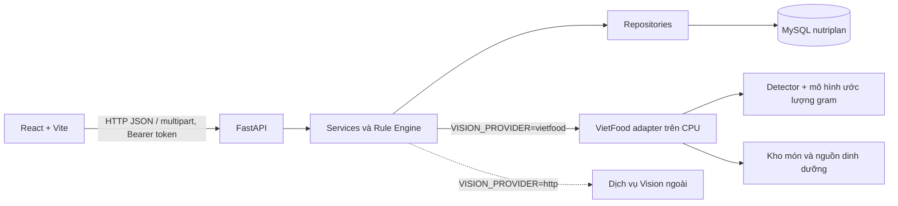

# Kiến trúc hệ thống NutriPlan

> Trạng thái mã nguồn trên nhánh `Vanh`, 25/11/2026. Đây là ứng dụng demo hỗ trợ ghi nhận bữa ăn và lập thực đơn; dữ liệu mô phỏng và gợi ý AI không phải kết luận y khoa.

## Các thành phần đang chạy

| Thành phần | Vai trò hiện tại |
| --- | --- |
| [Frontend](../../frontend/src/App.jsx) | React 18, React Router, Vite. Các trang phiên, gia đình, ghi bữa ăn, nhật ký, thực đơn và consent gọi API thật qua [api.js](../../frontend/src/services/api.js) và [nutriplan.js](../../frontend/src/services/nutriplan.js). Token phiên được giữ trong `localStorage`. |
| [Backend](../../backend/app/main.py) | FastAPI: router → service → repository; kiểm tra Bearer token, quyền sở hữu hộ, đầu vào và consent. Giao dịch MySQL được commit khi request thành công, rollback khi có lỗi. |
| [Database](../../backend/app/db/schema.sql) | MySQL `nutriplan` lưu phiên, hộ, hồ sơ, danh mục món, bữa ăn, đánh giá, thực đơn, consent, rule và sự kiện sử dụng. Schema/migration chạy thủ công, không chạy khi khởi động API. |
| [VietFood](../../backend/app/services/vietfood.py) | Tải checkpoint trong `ai/models/vietfood`, nhận diện một ảnh trên CPU, ánh xạ nhãn sang ứng viên món trong KB và gợi ý gram cần người dùng xác nhận. Cần cài riêng `torch`, `torchvision` và [AI requirements](../../ai/requirements.txt). |

`VISION_PROVIDER` mặc định là `unavailable`; đặt `vietfood` để chạy model cục bộ. Chế độ `http` dùng Vision bên ngoài và yêu cầu consent gửi ảnh. `mock` chỉ dành cho demo/test. Chưa có dịch vụ RAG hoặc LLM vận hành; giải thích đánh giá hiện dùng mẫu câu cố định.

## Luồng ghi nhận bữa ăn

1. Giao diện tạo phiên ẩn danh và hộ; người dùng bật `store_health_profile` trước khi thêm thành viên.
2. Người dùng tải một ảnh lên `POST /meals/analyze` hoặc chọn món và gram thủ công bằng `POST /meals`. Backend lưu bữa `draft`. VietFood trả gợi ý nhận diện và gram; người dùng chọn đúng món trong danh mục, xác nhận/sửa gram.
3. `POST /meals/{id}/assessments` tính dinh dưỡng, áp dụng các rule hợp lệ cho thành viên. Kết quả có thể là `INSUFFICIENT_DATA` nếu thiếu bằng chứng.
4. `POST /meals/{id}/confirm` chỉ xác nhận khi đánh giá đủ điều kiện. `GET /meals?status=all` cho nhật ký gồm cả bản nháp và bữa đã xác nhận; giao diện có thể mở lại bản nháp.

Ảnh đi qua bộ nhớ backend để suy luận; bảng `MEAL` ghi số ảnh, không lưu tệp ảnh. Bữa ăn có phiên bản và lịch sử hoàn tác. Tổng dinh dưỡng chỉ được tính cho chất có dữ liệu nguồn phù hợp; giá trị thiếu không được diễn giải là 0.

## Luồng thực đơn

Frontend gọi các API `menu-plans` để sinh tối đa ba ngày cho một thành viên, xem danh sách/chi tiết, tìm món thay thế, đổi/khóa món, sinh lại phần chưa khóa, hoàn tác, kiểm tra, xuất PDF/HTML và xóa. Backend yêu cầu hồ sơ, mục tiêu năng lượng, consent, dữ liệu món và rule đủ điều kiện; nếu không tìm được thực đơn hợp lệ thì trả lỗi thay vì tự nới ràng buộc cứng. Xem [hướng dẫn backend](../../backend/README.md) để biết các endpoint.

## Giới hạn cần nêu khi demo và review

- Phiên là ẩn danh, chưa có đăng nhập email/mật khẩu hoặc vai trò người dùng. Token ở `localStorage` chỉ phù hợp phạm vi demo hiện tại.
- Checkpoint VietFood có trong repository nhưng ước lượng gram vẫn mang trạng thái thử nghiệm. [Báo cáo độ phủ KB](../../data/knowledge_base/vietfood/reports/coverage_report.json) ghi 150 mục thực phẩm; không phải mọi lớp model đều có ứng viên món đã xác minh.
- Seed rule minh họa bị tắt. Không bật rule thiếu nguồn hoặc diễn giải `INSUFFICIENT_DATA` là món an toàn. Điều này có thể giữ bữa ở dạng nháp và khiến sinh thực đơn thất bại.
- Các trang frontend đã nối API, nhưng chưa có kiểm thử giao diện tự động đầy đủ. [Test hợp đồng API frontend](../../frontend/tests/api.test.js), test backend và test AI không thay thế kiểm thử thao tác người dùng trên trình duyệt.
- Không có kho ảnh, vector store, hệ thống triển khai production hoặc đánh giá lâm sàng trong phạm vi hiện tại.

## Chạy và kiểm chứng

Xem [quy trình E2E](../E2E_TESTING.md) để chuẩn bị MySQL, cài model và chạy hai ứng dụng. Hợp đồng API đang chạy là `/openapi.json` do FastAPI sinh; [OpenAPI tĩnh](../../backend/openapi.yaml) dùng tiền tố `/api/v1` cũ nên không dùng làm nguồn kiểm chứng endpoint hiện tại.
