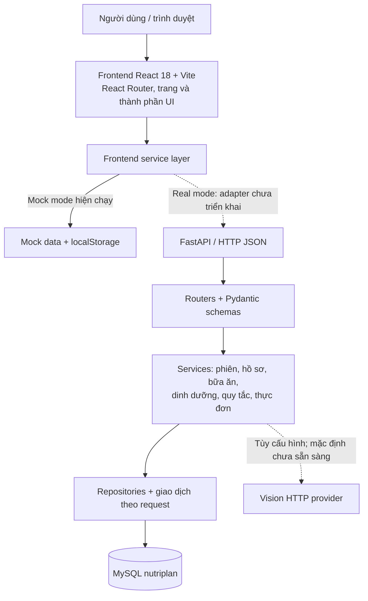
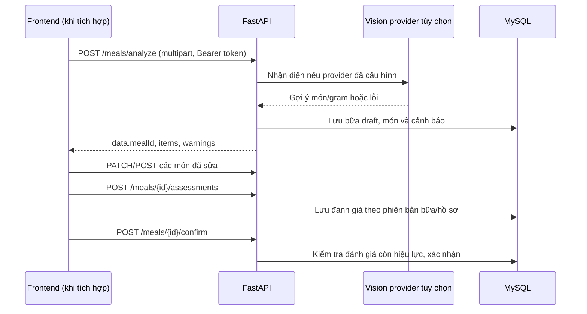

# Kiến trúc hệ thống NutriPlan

> **Trạng thái:** mô tả mã nguồn hiện có tại ngày 20/11/2026. Tài liệu tham khảo về cách trình bày và các nhóm yêu cầu: *VietFood_Kien_truc_va_dac_ta_toan_he_thong.pdf* do nhóm cung cấp. Các công nghệ và năng lực của VietFood không mặc nhiên là năng lực của NutriPlan.

## 1. Kiến trúc tổng thể

NutriPlan hiện gồm một ứng dụng web React/Vite và một ứng dụng API FastAPI dạng đơn khối, dùng MySQL. Frontend chạy độc lập ở **mock mode**: service đọc/ghi dữ liệu mẫu trong `localStorage`; chế độ `real` mới là điểm mở rộng, chưa có API adapter. Vì vậy hai ứng dụng **chưa được kết nối trong luồng người dùng hiện tại**.

| Tầng | Công nghệ và trách nhiệm hiện có | Ranh giới |
| --- | --- | --- |
| Giao diện | React 18, React Router, Vite, CSS; trang gia đình, ảnh bữa ăn, nhật ký, thực đơn, quyền riêng tư | Toàn bộ thao tác dữ liệu đi qua [frontend service](../../frontend/src/services/nutriplan.js). |
| API | Python 3.11+, FastAPI, Pydantic; xác thực phiên, kiểm tra quyền sở hữu, validation và điều phối nghiệp vụ | [Routers](../../backend/app/routers/) → [services](../../backend/app/services/) → [repositories](../../backend/app/repositories/). |
| Dữ liệu | MySQL qua `mysql-connector-python`; mỗi request có kết nối và giao dịch | [Schema](../../backend/app/db/schema.sql) và migration E2E ở `backend/app/db/`. |
| Nhận diện ảnh | Adapter HTTP trong backend; cấu hình `unavailable` mặc định, `mock` chỉ cho môi trường demo/test | Chưa có Vision Worker/model chạy trong repository. |

Không có Caddy, Next.js, PostgreSQL, S3, Core Runner, Nutrition API, Decision API, CP-SAT, RAG hoặc LLM độc lập trong bản triển khai hiện tại. Các thư mục `ai/`, `deploy/`, `contracts/` và `data/` chủ yếu là khung `.gitkeep`.

## 2. Hai luồng nghiệp vụ chính

### A. Ghi nhận bữa ăn

**Trong giao diện đang chạy:** chọn ảnh → nhận diện giả lập → sửa tên món/khẩu phần → xem đánh giá minh họa → lưu nhật ký demo trong trình duyệt. Ảnh chỉ dùng để xem trước, không được ghi vào `localStorage`.

**Khi nối với API hiện có:** tạo phiên và hộ → ghi nhận đồng ý cần thiết → gửi 1–5 ảnh đến `POST /meals/analyze` để tạo bữa **draft** → tra `GET /dishes` và sửa/thêm món bằng `dishId`, `grams` → `POST /meals/{id}/assessments` theo thành viên → `POST /meals/{id}/confirm` → đọc nhật ký qua `GET /meals`. Ảnh được xử lý trong bộ nhớ backend; cơ sở dữ liệu hiện chỉ ghi số ảnh, không lưu tệp ảnh. `VISION_PROVIDER` mặc định là `unavailable`, nên bước phân tích ảnh cần một provider đã cấu hình hoặc demo mode rõ ràng.

Đánh giá thiếu quy tắc hoặc nguồn dữ liệu đã xác minh trả `INSUFFICIENT_DATA`; API có thể từ chối xác nhận. Giao diện cần hiển thị lý do và cho sửa/bổ sung dữ liệu thay vì diễn giải đây là kết luận y khoa.

### B. Tạo thực đơn

**Trong giao diện đang chạy:** sinh, đổi và khóa món bằng mock service. **Trong backend:** `POST /menu-plans/generate` tạo thực đơn **một ngày cho một thành viên**, sau khi kiểm tra consent, mục tiêu năng lượng, món có dữ liệu và quy tắc; `GET /menu-plans/{id}` đọc kế hoạch đã lưu. Backend chưa có API đổi/khóa món, tạo 1–7 ngày hoặc in thực đơn. Nếu thiếu dữ liệu hay không có tổ hợp khả thi, API trả lỗi thay vì tự tạo kế hoạch.

## 3. Phạm vi và mức triển khai

| Năng lực | Hiện trạng | Giới hạn cần nêu khi demo |
| --- | --- | --- |
| Phiên, hộ, hồ sơ | Backend tạo phiên ẩn danh bằng Bearer token, tạo hộ, CRUD hồ sơ; frontend có đăng nhập demo riêng | Chưa có email/mật khẩu thật, vai trò người chăm sóc hoặc quản trị. |
| Consent | Backend đọc/cập nhật consent theo hộ và lưu lịch sử; frontend chỉ có công tắc demo | Chưa nối dữ liệu; API mới yêu cầu `store_health_profile` trước một số thao tác. |
| Nhận diện ảnh | Backend kiểm tra JPEG/PNG/WebP, 1–5 ảnh, tối đa 8 MB/ảnh và có HTTP adapter | Chưa có model trong repo, provider mặc định không sẵn sàng; không có box hay lượng ăn được xác thực. |
| Dinh dưỡng và đánh giá | Tính kcal, protein, carb, fat theo 100 g; đánh giá bằng quy tắc đã xác minh | Thiếu chất/nguồn thì tổng tương ứng là `null`; chưa có bộ đánh giá bệnh lý được xác thực. |
| Nhật ký | Backend liệt kê bữa đã xác nhận, lọc thành viên/ngày, phân trang | Frontend đang dùng nhật ký mock; chưa có tổng ngày hoặc trạng thái “ngày đã đủ”. |
| Thực đơn | Backend sinh một ngày, một thành viên; frontend có thao tác mock mở rộng | Đổi/khóa món và nhiều ngày chưa có API. |
| Quản trị, xuất/xóa, RAG/LLM | Chưa triển khai | Không trình bày như tính năng hiện có. |

Ngoài phạm vi hiện tại: chẩn đoán, kê đơn, điều trị, khẳng định món “an toàn”, ước lượng chính xác phần ăn chỉ từ ảnh, và các kết luận lâm sàng chưa được kiểm định.

## 4. Giả định và giới hạn dữ liệu

- Hồ sơ sức khỏe, dị ứng, mục tiêu và consent do người dùng cung cấp. Backend không suy bệnh từ ảnh. Dữ liệu demo/seed là mô phỏng.
- Nhận diện chỉ là gợi ý. Món và khối lượng cần được người dùng xác nhận; backend dùng gram do provider trả hoặc khẩu phần mặc định có dữ liệu. `referenceObject` được nhận ở API nhưng chưa dùng để ước lượng gram.
- Dinh dưỡng tính theo dữ liệu trên 100 g của `FOOD_ITEM`. Nếu một món thiếu một chất, tổng chất đó trả `null`, không thay bằng 0.
- [Rule engine](../../backend/app/services/rule_engine.py) chỉ dùng quy tắc đang hoạt động, đã xác minh; thiếu nguồn dinh dưỡng, dữ liệu dị ứng hoặc quy tắc trả `INSUFFICIENT_DATA`. Hiện chưa cấu hình đánh giá riêng theo bệnh lý.
- API ghi `eatenAt` theo kiểu thời gian; chưa có logic ngày nhật ký theo múi giờ hộ. Cần chốt múi giờ khi tích hợp giao diện và tổng ngày.
- Ảnh hiện đi qua bộ nhớ của backend đến Vision provider khi được cấu hình và consent cho gửi ảnh ra ngoài đã được cấp. Chưa có kho ảnh hoặc chính sách lưu giữ/xóa ảnh tại server.

## 5. Đặc tả chức năng theo hệ hiện có

| Mã | Đầu vào → kết quả | Trạng thái |
| --- | --- | --- |
| S1 · Hộ, hồ sơ và consent | Phiên ẩn danh + hộ + dữ liệu thành viên → hồ sơ thuộc phiên; cập nhật consent theo hộ | Backend có; frontend chưa nối. |
| S2 · Ảnh và xác nhận món | Ảnh + hộ/thành viên → bữa draft và gợi ý; chọn món từ danh mục, sửa gram, đánh giá rồi xác nhận | API có; phụ thuộc Vision provider và dữ liệu đã xác minh. UI đang mô phỏng. |
| S3 · Dinh dưỡng và nhật ký | Món + gram → dinh dưỡng từng món/bữa; bữa confirmed → danh sách nhật ký | Backend có phần bữa; chưa có tổng ngày. |
| S4 · Đánh giá có lý do | Hồ sơ + bữa → mức, lý do, chỉ số và phiên bản quy tắc hoặc `INSUFFICIENT_DATA` | Chỉ quy tắc đã xác minh; không có RAG/LLM. |
| S5 · Thực đơn | Một hồ sơ + ngày + số bữa + món ưu tiên/loại trừ → kế hoạch một ngày hoặc lý do thất bại | Backend có phần sinh/đọc; đổi/khóa chỉ là mock UI. |
| S6 · Vận hành và quyền dữ liệu | Health check, khởi tạo/seed database development | Chưa có quản trị bản phát hành hoặc yêu cầu xuất/xóa. |

## 6. Giao tiếp API và mô hình dữ liệu

**Nguồn hợp đồng đang chạy:** router và `/openapi.json` do FastAPI sinh. [OpenAPI tĩnh](../../backend/openapi.yaml) dùng tiền tố `/api/v1` và chưa khớp API hiện tại; các router thực tế dùng đường dẫn gốc. [Kiểm kê API E2E](../API_E2E.md) ghi thêm request/response và mã lỗi.

| Nhóm | Endpoint chính hiện có |
| --- | --- |
| Phiên và hồ sơ | `POST /sessions`, `POST /households`, `POST /households/{id}/members`, CRUD `/profiles`, `POST/GET /members` |
| Consent và danh mục | `GET/PUT /consents`, `GET /dishes` |
| Bữa ăn | `POST /meals/analyze`, `GET /meals`, `GET /meals/{id}`, `PATCH /meals/{id}/items/{itemId}`, `POST /meals/{id}/items`, `POST /meals/{id}/assessments`, `POST /meals/{id}/confirm` |
| Thực đơn và tình trạng | `POST /menu-plans/generate`, `GET /menu-plans/{id}`, `GET /health` |

Phiên trả `session_id` và `token`; các request được bảo vệ dùng `Authorization: Bearer <token>`. Endpoint cũ về phiên/hộ/hồ sơ dùng một số trường `snake_case`; API E2E mới thường dùng `{"data": ...}` và `camelCase`, danh sách phân trang có `meta.nextCursor`. Frontend cần adapter để chuẩn hóa hai dạng này, không gắn URL hay trường của backend trực tiếp vào component. Lỗi nghiệp vụ dùng `{"error":{"code":"...","message":"..."}}`.

Các nhóm bảng chính trong [schema MySQL](../../backend/app/db/schema.sql):

- **Quyền sở hữu:** `SESSION` → `HOUSEHOLD` → `MEMBER`; token chỉ lưu dạng băm SHA-256.
- **Danh mục:** `FOOD_ITEM`, `NUTRITION_RULE` (nguồn và phiên bản quy tắc).
- **Bữa ăn:** `MEAL`, `MEAL_ITEM`, `MEAL_MEMBER`, `ASSESSMENT`; đánh giá tham chiếu phiên bản bữa và hồ sơ.
- **Thực đơn:** `MENU_PLAN`, `MENU_ITEM`.
- **Đồng ý:** `CONSENT`, `CONSENT_HISTORY`.

Mỗi request backend dùng một kết nối MySQL; [database layer](../../backend/app/db/database.py) commit khi thành công và rollback khi có ngoại lệ. Không có PostgreSQL, vector store hay kho ảnh hoạt động trong repository.

## 7. Bảo mật, vận hành và kiểm chứng

| Chủ đề | Hiện có | Cần làm trước khi dùng dữ liệu thật / phát hành |
| --- | --- | --- |
| Truy cập | Bearer token, kiểm tra quyền sở hữu theo phiên; tài nguyên phiên khác trả 404; CORS cho Vite local | Xác thực người dùng thật, vai trò/ủy quyền, TLS khi triển khai, vòng đời token. |
| Quyền riêng tư | Consent theo hộ và lịch sử; kiểm tra consent ở API E2E; không log body/ảnh trong handler lỗi | Chính sách lưu giữ, xuất/xóa dữ liệu, kiểm tra luồng gửi ảnh ra provider. |
| Dữ liệu và chất lượng | Validation Pydantic, kiểm tra MIME/chữ ký ảnh, quy tắc thiếu bằng chứng từ chối đánh giá chắc chắn | Dữ liệu dinh dưỡng và quy tắc có nguồn, chuyên gia xác minh; kiểm định model trên ảnh thực tế. |
| Chạy cục bộ | Frontend `npm run dev` ở mock mode; backend Uvicorn + MySQL `nutriplan`; `/health` kiểm tra DB | API adapter frontend, môi trường triển khai, giám sát/backup/khôi phục. |
| Kiểm thử | `npm run build`; pytest backend, gồm test tích hợp dùng rollback | E2E FE–BE với consent, ảnh lỗi, dữ liệu thiếu, bữa nhiều thành viên, thực đơn không khả thi. |

### Trình tự tích hợp tiếp theo

1. Giữ mock mode; thêm API adapter và cấu hình base URL riêng cho real mode. Dựa vào `/openapi.json` sinh từ FastAPI, không dùng tiền tố `/api/v1` của tài liệu tĩnh khi chưa triển khai.
2. Nối phiên ẩn danh → hộ → consent → thành viên, ánh xạ `snake_case`/`camelCase` tại service layer.
3. Nối danh mục và luồng bữa draft → sửa món → đánh giá → xác nhận → nhật ký. Hiển thị `warnings`, `INSUFFICIENT_DATA` và lỗi có mã.
4. Nối tạo/đọc thực đơn một ngày. Giữ đổi/khóa món ở mock mode hoặc thiết kế API thật trước khi bật thao tác đó trong real mode.

### Nguồn đối chiếu trong repository

- [Hướng dẫn frontend](../../frontend/README.md), [service và cấu hình mock](../../frontend/src/services/nutriplan.js), [các route UI](../../frontend/src/App.jsx).
- [Hướng dẫn backend](../../backend/README.md), [khởi tạo FastAPI](../../backend/app/main.py), [cấu hình](../../backend/app/core/config.py), [schema](../../backend/app/db/schema.sql).
- [Kiểm kê API E2E](../API_E2E.md) và [hướng dẫn kiểm thử E2E](../E2E_TESTING.md).
